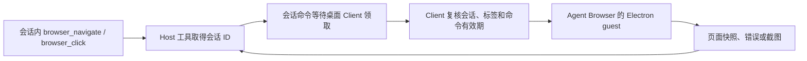

# DSH 侧栏浏览器机制

适用基线为 DSH Desktop 0.2.1-rc.5（build d4db512，Electron 44.7.0）。产品边界见[产品形态](product-form.md)，代码来源见[实现路线](implementation-route.md)。

| 机制 ID | 触发与前置条件 | 执行、状态与证据 | 失败和恢复 |
| --- | --- | --- | --- |
| SB-M01 | 当前 DSH 会话调用 `browser_*` | [工具](../src/tool.ts)取调用的真实会话 ID。[Host](../src/sidebar.ts)用 DSH connection admission 校验 owner。在[命令桥](../src/sidebar-bridge.ts)中，命令按会话、接收器和请求 ID 匹配，同一会话只执行一个在途命令。 | 找不到当前桌面会话时会超时。同会话并发返回忙状态。等待领取的命令取消后不可被领取，迟到回包不可完成新命令。 |
| SB-M02 | 当前活动会话收到有效命令 | [Client](../src/sidebar-client.ts)通过 DSH 右栏 slot 创建 Agent Browser 标签，后续按原生标签出现实例聚焦。每个网页元素由插件自己创建和持有。[Guest](../src/guest.ts)用 DSH preload 申请租约和 partition，由 Electron 主进程配置沙箱。每个会话独立，同一会话在桌面进程内复用该 partition。 | 改变会话或选择其他网页后，尚未发出的动作停止。关闭标签释放网页租约。窗口退出会释放 guest，站点进程内状态会结束。 |
| SB-M03 | 页已打开且在 Agent Browser 内可见 | [快照引擎](../src/injected.ts)返回有界 DOM 摘要和元素引用。点击先命中测试，再发真实 Electron 鼠标按下和抬起。填表后触发输入和变更事件。截图携带捕获时的 URL，Host 写入 DSH 图片附件。 | 引用过期需重新快照。遮挡的目标被拒绝。全页截图和 `networkidle` 等待不可用，使用视口截图或完整加载等待。 |
| SB-M04 | 工具执行中取消、超时，或页面挂起 | Client 核对 Host 请求仍存在，在实际动作前复核。导航监听取消并调用 guest 的 stop。客户端等待有界，旧结果与新命令分开匹配。 | 已发出的鼠标或键盘输入可能已经产生作用。取消后应先快照观察页面，再决定是否重试。 |
| SB-M05 | 发起导航、提取或执行表达式 | 工具导航接受 HTTP(S)，并拒绝 URL 凭据。可配置主机允许域。可见网页的权限、下载和重定向由 DSH 主进程策略治理。普通表单值不会进入提取结果，密码和文件输入保留给用户。 | 域名约束是针对工具初始导航、已知链接和操作前后页面检查的约束。网页子资源和手动导航路径不受插件的完整网络出口拦截。 |

Skill 可以调整何时打开、何时要求用户接手、出现过期引用时是否重新获取快照，以及如何呈现截图和失败。重复动作前先看当前页面。程序约束包括会话绑定、单次领取、工具 URL 校验、默认关闭的求值、guest 生命周期和 DSH 沙箱。启用辅助提取模型时，选定网页数据会传给配置的模型。浏览器进程和凭据的控制边界见 SB-M02 与 SB-M05。

## 复现

- `pnpm test` 验证命令匹配、取消、超时、工具注册、URL 和快照文本。
- `pnpm build` 生成 Host 入口及 DSH 客户端 bundle。
- `node scripts/smoke-desktop.cjs "E:/dsh/DeepSeek Harness.exe"` 在隔离的原装 rc.5 中装载生产构建，通过已注册的 DSH 工具在原生 guest 执行本机合成页验证。测试驱动直接调用 DSH 工具运行时。真实站点兼容、外部模型选择工具和其他 Desktop 版本需各自验证。

首版运行结果为 15 项单元测试通过。使用 tarball 在隔离安装目录重建 package 后，原装 rc.5 执行了导航、可信点击、填写、按键、截图、标签切换和关闭。分栏测试先聚焦另一标签，再验证操作仍落在原先唯一可见的 guest。弹窗留在后台，切换后可以操作。取消已发出的挂起导航后，下一次导航成功。验证页只使用 localhost。
